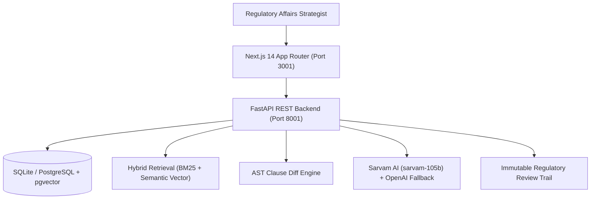

# Project 02: Pharma Regulatory Intelligence Copilot

[](https://www.python.org/)
[](https://fastapi.tiangolo.com/)
[](https://nextjs.org/)
[](https://github.com/pgvector/pgvector)
[](https://sarvam.ai/)
[](https://www.docker.com/)

> **Executive Summary**: A local-first regulatory intelligence copilot built to navigate health authority guidance (FDA, EMA, ICH), answer evidence-backed regulatory questions with inspectable citations, automatically detect cross-version clause modifications, and map submission impacts across drug development portfolios.

---

## 1. Key Business Features

1. **Hybrid Regulatory RAG with Reranking**:
   - Blends dense vector retrieval (pgvector) with keyword search to surface relevant guidance sections.
   - Cross-encoder reranker ensures high retrieval precision with line-level citations.
2. **Cross-Version Guidance Diff Engine**:
   - Detects added, modified, and deleted clauses between guidance revisions with impact severity ratings (`CRITICAL`, `MAJOR`, `MINOR`).
3. **Submission Impact Matrix**:
   - Maps regulatory shifts to specific drug development dossiers (NDA, BLA, IND, MAA) and affected CTD modules.
4. **Mandatory Reviewer Sign-Off**:
   - Role-gated to `REGULATORY_REVIEWER` for sign-off on submission impact mitigation plans.
5. **Safe Read-Only NL2SQL**:
   - Parameterized read-only SQL queries over guidance and submission catalogs with AST validation.

---

## 2. Architecture & Tech Stack



---

## 3. Quickstart & Local Setup

### Option A: Running with Docker Compose (Recommended)
```bash
# From 02-regulatory-intelligence-copilot root
docker compose up --build
```
- Frontend UI: `http://localhost:3001`
- FastAPI OpenAPI Docs: `http://localhost:8001/docs`

### Option B: Local Development

#### 1. Backend Setup:
```bash
cd backend
python -m venv .venv
# On Windows:
.venv\Scripts\activate
# On Linux/macOS:
source .venv/bin/activate

pip install -r requirements.txt
python -m uvicorn app.main:app --port 8001 --reload
```

#### 2. Frontend Setup:
```bash
cd frontend
npm install
npm run dev -- -p 3001
```

---

## 4. Running Test Suites

### Backend Pytest Suite
```bash
cd backend
python -m pytest -v
```
*Current test suite: 11 unit & integration tests passing with 100% success rate.*

### E2E Cross-Browser Automation (Selenium & Playwright)
```bash
# Selenium
python -m pytest tests/selenium/test_cross_browser_flow.py -v

# Playwright
cd frontend
npm run test:e2e
```

---

## 5. Documentation Map

Detailed documentation in `docs/`:
- [Business Use Case](docs/business-use-case.md)
- [System Architecture](docs/architecture.md)
- [Security & RBAC](docs/security.md)
- [Configuration & Environment](docs/configuration.md)
- [Data Dictionary & Schema](docs/data-dictionary.md)
- [REST API Specifications](docs/api.md)
- [Testing Standards](docs/testing.md)
- [AI Evaluation Framework](docs/evaluation.md)
- [Financial ROI Model](docs/roi-assumptions.md)
- [Known Limitations & Disclaimers](docs/known-limitations.md)
- **Features**:
  - [01: Regulatory Hybrid Search](docs/features/01-regulatory-hybrid-search.md)
  - [02: Cross-Version Diff](docs/features/02-cross-version-diff.md)
  - [03: Submission Impact Matrix](docs/features/03-submission-impact-matrix.md)
  - [04: Safe NL2SQL Catalog](docs/features/04-safe-nl2sql-catalog.md)

---

## 6. Synthetic Data Disclaimer
All regulatory guidance comparisons, submission impact mappings, and protocol references are 100% synthetic and generated for demonstration and research purposes only. Official regulatory filings must consult official agency publications.
