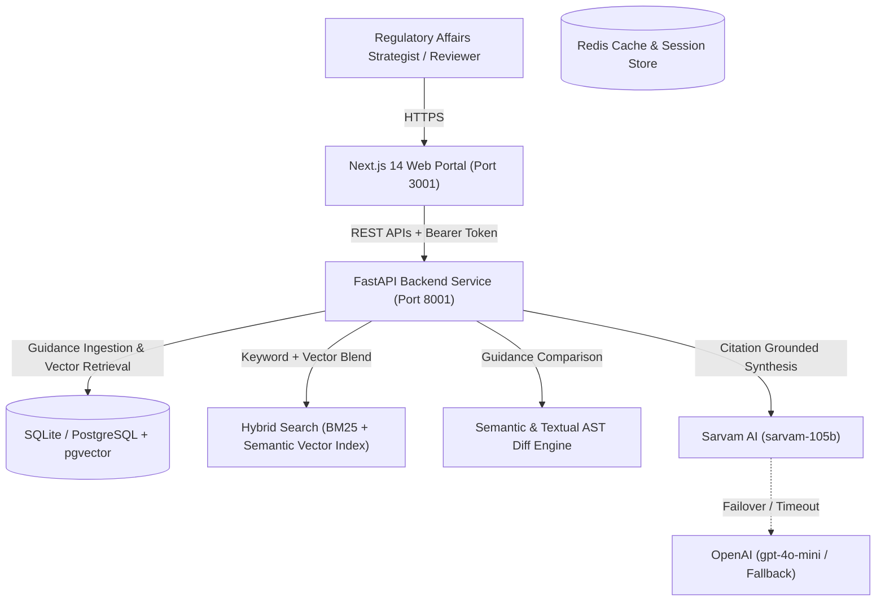

# System Architecture: Regulatory Intelligence Copilot

## 1. High-Level Context & C4 Architecture

The **Regulatory Intelligence Copilot** assists regulatory affairs strategists in navigating complex FDA, EMA, and ICH guidance documents, comparing cross-version protocol changes, evaluating submission impact matrices, and querying regulatory catalogs with citation grounding.

---

## 2. Core Technical Modules

### A. Hybrid Regulatory Retrieval (RAG + Reranking)
1. **Document Ingestion**: Guidance documents (FDA, EMA, ICH) parsed and chunked into paragraph-level snippets.
2. **Hybrid Search**: Combines full-text keyword retrieval (BM25-style) with dense vector embeddings in PostgreSQL pgvector.
3. **Cross-Encoder Reranking**: Re-orders candidate snippets based on semantic query-document alignment.
4. **Citation Grounding**: Every AI response must cite the document title, section number, and line reference.

### B. Cross-Version Regulatory Diff Engine
1. **Version Comparison**: Automatically identifies added, modified, and removed clauses between guidance revisions (e.g., Draft vs. Final Guidance).
2. **Impact Severity Grading**: Labels each alteration as `CRITICAL`, `MAJOR`, or `MINOR`.

### C. Submission Impact Matrix
1. Maps regulatory requirement shifts against planned submission dossiers (NDA, BLA, IND, MAA).
2. Flags sections requiring protocol amendments or clinical re-analysis before submission.

### D. Safe Read-Only NL2SQL
1. Parameterized querying over the guidance and submission database.
2. Guaranteed read-only execution with strict keyword blacklisting.
