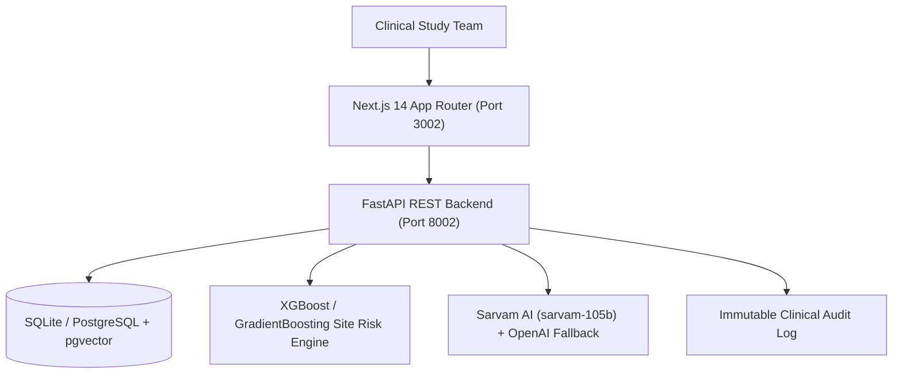

# Project 03: Clinical Trial Intelligence & Patient-Trial Matching Platform

[](https://www.python.org/)
[](https://fastapi.tiangolo.com/)
[](https://nextjs.org/)
[](https://xgboost.readthedocs.io/)
[](https://sarvam.ai/)
[](https://www.docker.com/)

> **Executive Summary**: A local-first clinical operations (ClinOps) intelligence platform that automates patient-trial eligibility screening with criterion-level `PASS`/`FAIL`/`UNKNOWN` explainability, forecasts clinical research site enrollment risks via predictive machine learning, and provides immutable human-in-the-loop review governance for clinical trial leads.

---

## 1. Key Business Features

1. **Criterion-by-Criterion Patient Screening**:
   - Matches structured & unstructured EHR profiles against complex protocol inclusion/exclusion criteria.
   - Evaluates each criterion individually, producing explicit `PASS`, `FAIL`, or `UNKNOWN` (missing biomarker/lab) status tags.
2. **Predictive Site Enrollment Risk Radar**:
   - Machine learning model (`GradientBoostingClassifier` / XGBoost) trained on historical trial operations telemetry.
   - Forecasts the probability of trial sites missing target accrual deadlines 60–90 days before failure.
3. **Safe ClinOps NL2SQL**:
   - Natural language queries over trial protocols, site metrics, and patient screening velocity with SQL injection protection and schema allowlisting.
4. **Mandatory Human-in-the-Loop Governance**:
   - Enforces `CLINICAL_REVIEWER` sign-off and reasons justification before patient status transitions, recording immutable audit records for regulatory compliance.

---

## 2. Architecture & Technology Stack



---

## 3. Quickstart & Local Setup

### Option A: Running with Docker Compose (Recommended)
```bash
# From 03-clinical-trial-intelligence root
docker compose up --build
```
- Frontend UI: `http://localhost:3002`
- FastAPI OpenAPI Docs: `http://localhost:8002/docs`

### Option B: Local Development

#### 1. Backend Setup:
```bash
cd backend
python -m venv .venv
# On Windows:
.venv\Scripts\activate
# On Linux/macOS:
source .venv/bin/activate

pip install -r requirements.txt
python -m uvicorn app.main:app --port 8002 --reload
```

#### 2. Frontend Setup:
```bash
cd frontend
npm install
npm run dev -- -p 3002
```

---

## 4. Running Test Suites

### Backend Unit & Integration Tests (Pytest)
```bash
cd backend
python -m pytest -v
```
*Current test suite: 19 unit & integration tests passing with 100% success rate.*

### E2E Cross-Browser Automation (Selenium & Playwright)
```bash
# Selenium
python -m pytest tests/selenium/test_cross_browser_flow.py -v

# Playwright
cd frontend
npm run test:e2e
```

---

## 5. Documentation Map

Detailed technical and business documentation is maintained in the `docs/` folder:
- [Business Use Case](docs/business-use-case.md)
- [System Architecture](docs/architecture.md)
- [Security & RBAC](docs/security.md)
- [Configuration & Environment](docs/configuration.md)
- [Data Dictionary & Schema](docs/data-dictionary.md)
- [REST API Specifications](docs/api.md)
- [Testing Standards](docs/testing.md)
- [AI & ML Evaluation Framework](docs/evaluation.md)
- [Financial ROI Model](docs/roi-assumptions.md)
- [Known Limitations & Disclaimers](docs/known-limitations.md)
- **Features**:
  - [01: Patient-Trial Matching](docs/features/01-patient-trial-matching.md)
  - [02: Site Risk Forecasting](docs/features/02-site-risk-forecasting.md)
  - [03: Human-in-the-Loop Review](docs/features/03-human-in-the-loop-review.md)
  - [04: Safe ClinOps NL2SQL](docs/features/04-safe-clinops-nl2sql.md)

---

## 6. Synthetic Data Disclaimer
All patient records, clinical trial criteria, laboratory values, and investigator names are 100% synthetic and generated solely for algorithmic evaluation and demonstration. No real protected health information (PHI) is processed. This system provides decision support only and does not substitute for qualified clinical judgment.
