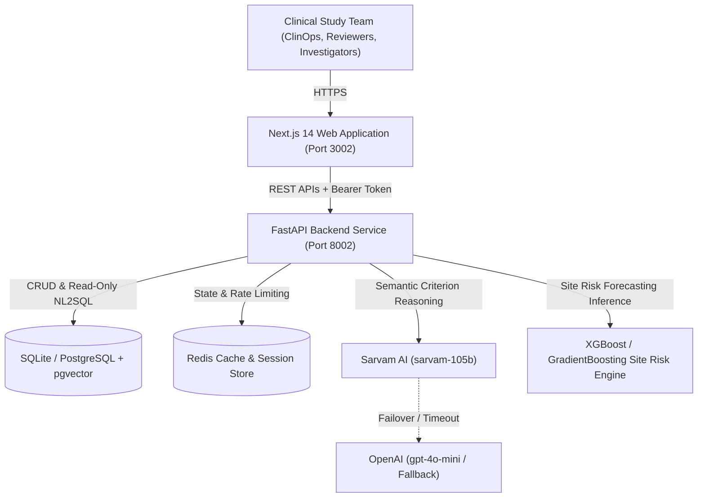

# System Architecture: Clinical Trial Intelligence Platform

## 1. High-Level Overview & C4 Context

The **Clinical Trial Intelligence & Patient-Trial Matching Platform** accelerates patient recruitment, automates clinical protocol criterion verification, and forecasts clinical trial site operational underperformance using predictive machine learning.

---

## 2. Component Architecture & Data Flows

### A. Patient-Trial Matching Pipeline
1. **Patient Ingestion**: Structured synthetic EHR data (age, gender, stage, ECOG score, histology, biomarkers, previous therapies, lab values).
2. **Deterministic Filter**: Instant numerical validation (e.g., `Age >= 18`, `Platelets >= 100,000 /uL`, `ECOG <= 1`).
3. **Semantic Criterion Verification**: Complex natural language criteria (e.g., *"No active central nervous system metastases unless treated and stable for >= 4 weeks"*) parsed via `LLMProviderInterface` (Sarvam AI primary, OpenAI fallback).
4. **Criterion Matrix Output**: Every inclusion/exclusion criterion labeled with explicit status:
   - `PASS`: Criterion verified against EHR facts.
   - `FAIL`: Criterion violated (e.g. prior immunotherapy within washout window).
   - `UNKNOWN`: Missing lab or biomarker test explicitly highlighted.
5. **Human Gate**: Results queued for `CLINICAL_REVIEWER` sign-off.

### B. Site Operational Risk Forecasting Engine
1. **Historical Telemetry Aggregation**: Monthly screening rate, screen failure rate, protocol deviation count, CRC turnover index.
2. **ML Inference**: `GradientBoostingClassifier` / `XGBoost` model predicts the probability of a trial site missing target enrollment by > 20%.
3. **Early Warning Radar**: Alerts ClinOps leads 60–90 days before trial milestones fail.

### C. Safe ClinOps NL2SQL
1. Parameterized read-only execution against SQLite / PostgreSQL catalog.
2. Schema allowlist preventing arbitrary table access.
3. Ast parsing with `sqlparse` blocking DDL/DML (`DROP`, `INSERT`, `UPDATE`, `ALTER`).

---

## 3. Technology Stack Justification

| Layer | Technology | Justification |
| :--- | :--- | :--- |
| **Frontend** | Next.js 14 (App Router) + React + TypeScript + Tailwind CSS | High-performance, responsive clinical portal avoiding Streamlit limitations. |
| **Icons & Charts** | Lucide React + Recharts | Accessible SVG icons and dynamic data visualization for enrollment curves. |
| **Backend** | Python 3.12 + FastAPI + Pydantic v2 | High-throughput asynchronous REST APIs with strict input validation. |
| **AI Layer** | Sarvam AI (`sarvam-105b`) + OpenAI (`gpt-4o-mini`) | Primary sovereign AI with resilient automatic fallback for zero downtime. |
| **Machine Learning**| scikit-learn / XGBoost | Deterministic, auditable tree-based tabular models for site risk scoring. |
| **Database** | SQLite (local) / PostgreSQL 16 (production) | Local zero-dependency setup with production pgvector compatibility. |
| **Containerization**| Docker Compose | Single-command portable local deployment. |
