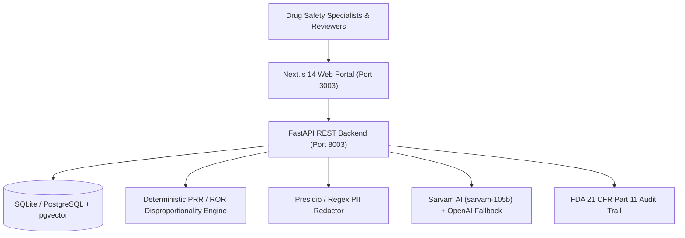

# Project 04: AI Pharmacovigilance & Safety Signal Intelligence Platform

[](https://www.python.org/)
[](https://fastapi.tiangolo.com/)
[](https://nextjs.org/)
[](https://en.wikipedia.org/wiki/Pharmacovigilance)
[](https://sarvam.ai/)
[](https://www.docker.com/)

> **Executive Summary**: A local-first drug safety and pharmacovigilance platform built to ingest unstructured adverse event narratives with automated PII scrubbing, calculate real-time deterministic statistical disproportionality signals (PRR, ROR, Chi-square), assemble FDA product label and PubMed literature evidence, and enforce mandatory clinical reviewer sign-off with FDA 21 CFR Part 11 compliant audit logging.

---

## 1. Key Business Features

1. **Deterministic Disproportionality Signal Detection**:
   - Calculates Proportional Reporting Ratio (PRR), Reporting Odds Ratio (ROR), 95% confidence intervals, and Chi-square with Yates correction over incoming case streams.
   - Evaluates Evans criteria without LLM hallucination of numerical metrics.
2. **Spontaneous Case Intake & PII Scrubbing**:
   - Automated redaction of patient names, phone numbers, emails, and identifiers into tokens.
   - Clinical entity extraction parsing suspect drugs, MedDRA adverse reactions, System Organ Classes, and hospitalization severity.
3. **Hybrid Evidence Retrieval & Investigator Briefings**:
   - Matches signals against FDA package inserts and PubMed literature.
   - Synthesizes objective briefings via Sarvam AI (`sarvam-105b`) with resilient OpenAI fallback.
4. **Mandatory Human-in-the-Loop Governance**:
   - Role-gated to `SAFETY_REVIEWER` for product label updates or surveillance escalations.
   - Cryptographically timestamped audit trail for regulatory inspection.
5. **Safe Pharmacovigilance NL2SQL**:
   - Read-only parameterized natural language querying over safety cases and signals.

---

## 2. Architecture & C4 Data Flow



---

## 3. Quickstart & Local Setup

### Option A: Running with Docker Compose (Recommended)
```bash
# From 04-pharmacovigilance-ai root
docker compose up --build
```
- Frontend UI: `http://localhost:3003`
- FastAPI OpenAPI Docs: `http://localhost:8003/docs`

### Option B: Local Development

#### 1. Backend Setup:
```bash
cd backend
python -m venv .venv
# On Windows:
.venv\Scripts\activate
# On Linux/macOS:
source .venv/bin/activate

pip install -r requirements.txt
python -m uvicorn app.main:app --port 8003 --reload
```

#### 2. Frontend Setup:
```bash
cd frontend
npm install
npm run dev -- -p 3003
```

---

## 4. Running Test Suites

### Backend Unit & Integration Tests (Pytest)
```bash
cd backend
python -m pytest -v
```
*Current test suite: 16 unit & integration tests passing with 100% success rate.*

### E2E Cross-Browser Automation (Selenium & Playwright)
```bash
# Selenium
python -m pytest tests/selenium/test_cross_browser_flow.py -v

# Playwright
cd frontend
npm run test:e2e
```

---

## 5. Documentation Map

Complete documentation is maintained in `docs/`:
- [Business Use Case](docs/business-use-case.md)
- [System Architecture](docs/architecture.md)
- [Security & RBAC](docs/security.md)
- [Configuration & Environment](docs/configuration.md)
- [Data Dictionary & Schema](docs/data-dictionary.md)
- [REST API Specifications](docs/api.md)
- [Testing Standards](docs/testing.md)
- [AI & Statistical Evaluation](docs/evaluation.md)
- [Financial ROI Model](docs/roi-assumptions.md)
- [Known Limitations & Disclaimers](docs/known-limitations.md)
- **Features**:
  - [01: Disproportionality Signal Detection](docs/features/01-disproportionality-signal-detection.md)
  - [02: Case Narrative Intake & Entity Extraction](docs/features/02-case-entity-extraction.md)
  - [03: Evidence Briefing & Literature Synthesis](docs/features/03-evidence-briefing.md)
  - [04: Safety Sign-Off & Audit Trail](docs/features/04-safety-signoff-audit.md)

---

## 6. Synthetic Data Disclaimer
All individual case safety reports, suspect pharmaceutical products, patient demographics, adverse reaction terms, and investigator comments are 100% synthetic and generated exclusively for algorithmic demonstration and research. This application provides decision support only and does not determine drug causality or substitute for clinical medical judgment.
