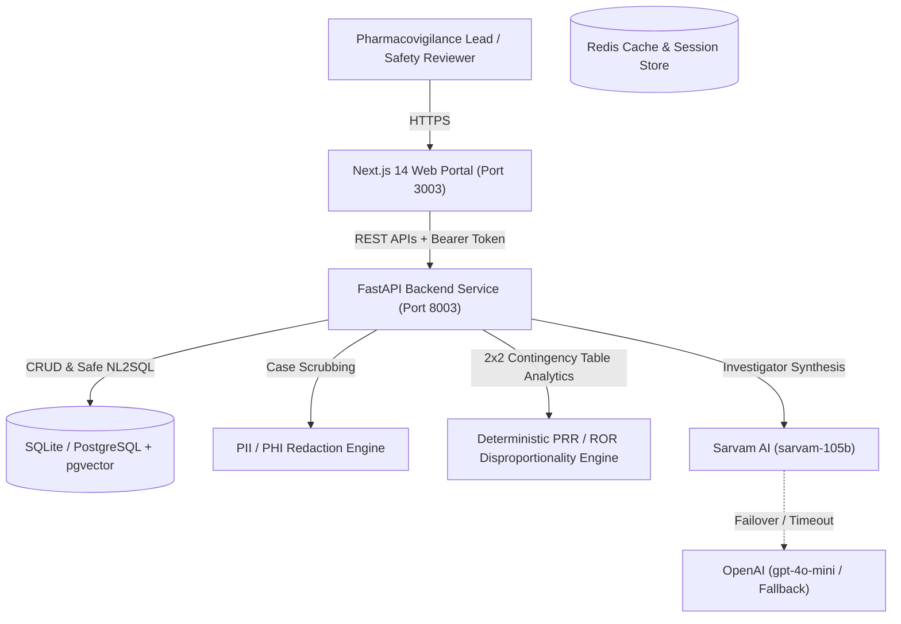

# System Architecture: AI Pharmacovigilance & Safety Signal Intelligence Platform

## 1. High-Level Context & C4 Flow

The platform accelerates individual case safety report (ICSR) ingestion, computes real-time statistical disproportionality metrics (PRR, ROR, Chi-square), retrieves product label and biomedical literature evidence, and coordinates human-in-the-loop review for drug safety physicians.

---

## 2. Core Functional Pipelines

### A. Case Intake & PII Redaction
1. **Raw Ingestion**: Spontaneous adverse event narrative uploaded by safety analyst.
2. **Deterministic Scrubbing**: Names, telephone numbers, emails, and medical record numbers (MRNs) scrubbed into tokenized tags (`[REDACTED_PHONE]`, `[REDACTED_EMAIL]`).
3. **Clinical Entity Extraction**: Automatically identifies suspect drug, MedDRA adverse event, System Organ Class (SOC), patient age/sex, and severity classification.
4. **Database Record Creation**: Persists scrubbed record to `safety_cases` table.

### B. Disproportionality Signal Detection
1. **2x2 Contingency Table**:
   - $a$: Suspect Drug + Adverse Event
   - $b$: Suspect Drug + Other Events
   - $c$: Other Drugs + Adverse Event
   - $d$: Other Drugs + Other Events
2. **Deterministic Computation**: Calculates Proportional Reporting Ratio (PRR), Reporting Odds Ratio (ROR), 95% confidence intervals, and Chi-square ($\chi^2$) with Yates continuity correction.
3. **Signal Classification**: Evans criteria ($a \ge 3$, $PRR \ge 2.0$, $\chi^2 \ge 4.0$).

### C. Evidence Synthesis & Investigator Briefing
1. **Hybrid Retrieval**: Queries FDA product insert warnings and indexed PubMed clinical literature.
2. **AI Synthesis**: Sarvam AI (`sarvam-105b`) generates objective briefings over pre-calculated figures.

### D. Human-in-the-Loop Decision Governance
1. Role-gated to `SAFETY_REVIEWER` or `ADMIN`.
2. Reviewer selects action (`ESCALATE_LABEL_UPDATE`, `CONTINUE_ROUTINE_SURVEILLANCE`, `DISMISS_SIGNAL`).
3. Permanent cryptographic audit sealing.
