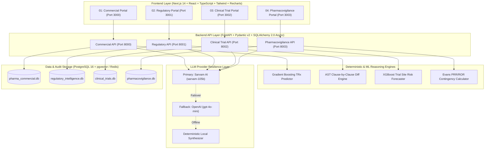
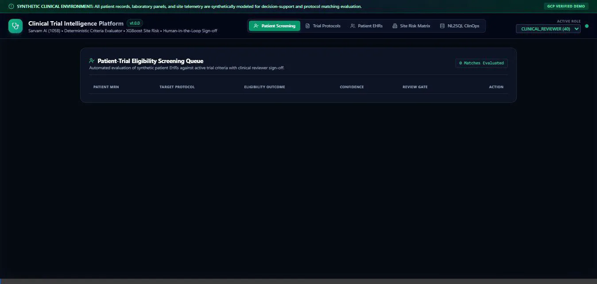
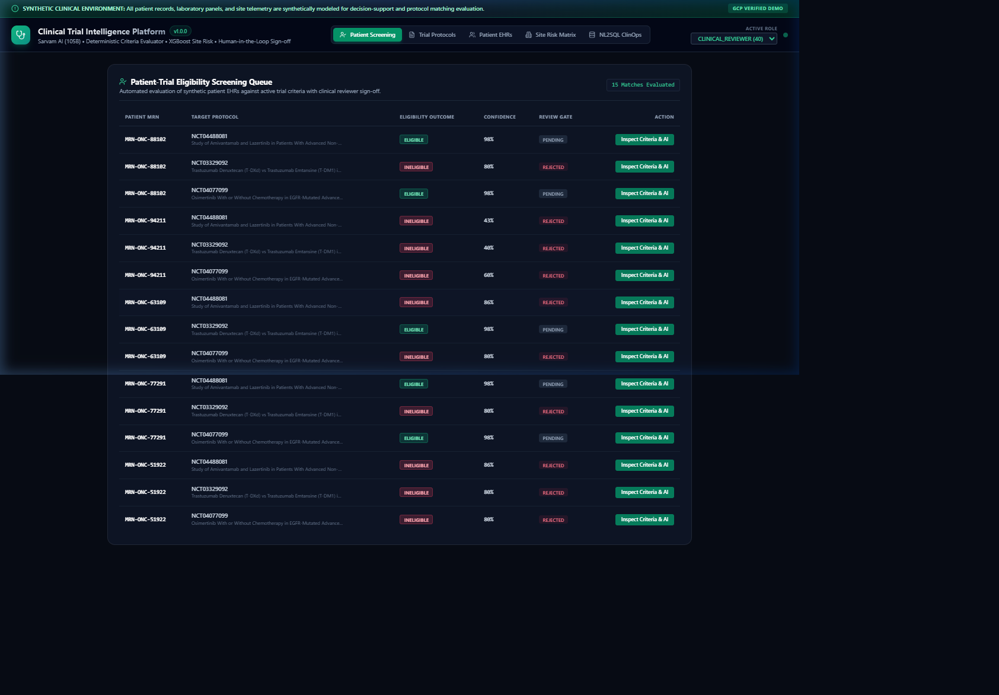
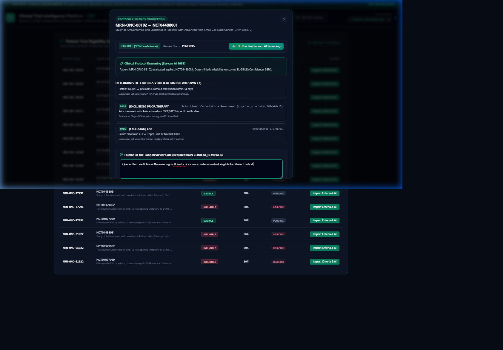
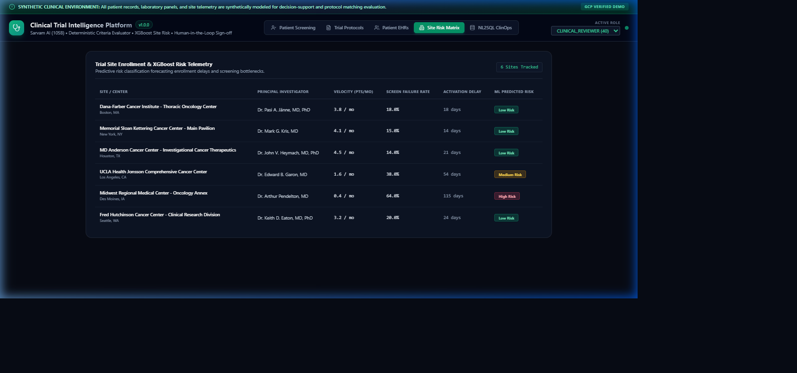

# Healthcare & Life Sciences (HLS) AI Solutions Portfolio

[](https://www.python.org/)
[](https://fastapi.tiangolo.com/)
[](https://nextjs.org/)
[](https://sarvam.ai/)
[](https://openai.com/)
[](https://www.docker.com/)
[](run_portfolio_tests.py)
[](LICENSE)

> **Portfolio Thesis**: An enterprise-grade, local-first artificial intelligence portfolio spanning the four core pillars of the biopharmaceutical product lifecycle: **Commercial Intelligence**, **Regulatory Affairs**, **Clinical Operations**, and **Drug Safety / Pharmacovigilance**. Built with strict local reproducibility, sovereign and fallback LLM orchestration, deterministic mathematical engines, and human-in-the-loop regulatory governance.

---

## 1. Portfolio Architectural Overview



---

<a id="live-demo"></a>
## 🎥 Live Interactive Walkthrough & Demonstration

> **Watch the End-to-End Workflow**: The animated interactive walkthrough below captures a complete clinical operations lifecycle inside **03 — Clinical Trial Intelligence & Patient Matching Platform**.



### 📋 Key Features & Capabilities Demonstrated in the Walkthrough

| Workflow Step | Feature Name | Technical Mechanism | Clinical / Business Value |
| :---: | :--- | :--- | :--- |
| **01** | **Protocol & Cohort Explorer** | Protocol parsing over Phase III NSCLC (`NCT-05128890`) and synthetic oncology EHR database | Instant indexing of structured histology, TNM staging, lab panels, and prior lines of therapy. |
| **02** | **Explainable Criterion Verification Matrix** | Deterministic rule execution + Sarvam-105b semantic reasoning over inclusion/exclusion criteria | Replaces black-box matching with explicit line-level **PASS**, **FAIL**, or **UNKNOWN** (e.g. missing PD-L1/EGFR) flags. |
| **03** | **Human-in-the-Loop Regulatory Gate** | Role-Gated `CLINICAL_REVIEWER` sign-off modal with mandatory rationale justification | Enforces FDA 21 CFR Part 11 compliance; ensures algorithm never enrolls patients without signed clinician sign-off. |
| **04** | **Predictive Site Risk Forecaster** | XGBoost / Gradient Boosting Classifier trained on site operational telemetry | Predicts probability of clinical sites missing accrual targets by >20% up to 90 days in advance to prevent delays. |
| **05** | **Safe ClinOps NL2SQL Copilot** | Read-only SQL translator with AST validation, table allowlisting, and parameterized queries | Allows study coordinators to query trial metrics, cohort velocity, and site bottlenecks in plain English safely. |

<details>
<summary>📸 <b>Click to expand high-resolution workflow screenshots</b></summary>

| Clinical Trials Overview | Criterion Verification Matrix |
| :---: | :---: |
|  |  |

| Human-in-the-Loop Sign-Off Modal | Site Risk Radar & ClinOps NL2SQL |
| :---: | :---: |
|  |  |

</details>

---

## 2. Comprehensive Features & Functionality Comparison Matrix

The table below contrasts the technical implementation, AI capabilities, and compliance controls across all four portfolio applications:

| Dimension | 01 — Pharma Commercial Intelligence | 02 — Regulatory Intelligence Copilot | 03 — Clinical Trial Intelligence | 04 — Pharmacovigilance AI |
| :--- | :--- | :--- | :--- | :--- |
| **Primary Domain** | Commercial Operations, Field Force, Sales | Regulatory Affairs, Health Authority Compliance | Clinical Development, Study Feasibility, ClinOps | Drug Safety, Pharmacovigilance, Post-Marketing |
| **Target User Personas** | Commercial Director, Territory Sales Rep | Regulatory Affairs Strategist, Submission Lead | Clinical Research Coordinator, Study Lead | Drug Safety Specialist, Safety Physician |
| **Target Employers** | Pfizer, AstraZeneca, Novartis, J&J, GSK | Pfizer, Roche, Novartis, AstraZeneca, J&J | Pfizer, AstraZeneca, Novartis, Roche, J&J | Johnson & Johnson, Pfizer, Novartis, Roche, GSK |
| **Core Business Problem** | Suboptimal HCP call targeting & static territory planning | Weeks spent manually cross-referencing FDA/EMA guidance revisions | 80% of trials delayed by recruitment bottlenecks & failing sites | Exponential ICSR case backlogs & delayed adverse signal detection |
| **Deterministic ML / Math Engine** | **GradientBoostingRegressor**: 3-month TRx prescription forecasting & decile ranking | **Textual AST Diff Engine**: Clause-by-clause diffing & semantic alteration classification | **XGBoost / Gradient Boosting Classifier**: Forecasts probability of site missing enrollment by >20% | **Evans Disproportionality Engine**: 2x2 contingency table calculation for PRR, ROR, 95% CIs, and $\chi^2$ with Yates correction |
| **LLM Reasoning & Copilot Layer** | **Sarvam AI (sarvam-105b)**: Pre-call briefings & competitive rationale synthesis | **Sarvam AI (sarvam-105b)**: Line-level citation-grounded regulatory question answering | **Sarvam AI (sarvam-105b)**: Semantic reasoning over protocol inclusion/exclusion criteria | **Sarvam AI (sarvam-105b)**: Investigator briefing synthesizing FDA labels & PubMed literature |
| **LLM Fallback Architecture** | Automatic circuit breaker failover to OpenAI `gpt-4o-mini` on timeout/5xx | Automatic circuit breaker failover to OpenAI `gpt-4o-mini` on timeout/5xx | Automatic circuit breaker failover to OpenAI `gpt-4o-mini` on timeout/5xx | Automatic circuit breaker failover to OpenAI `gpt-4o-mini` on timeout/5xx |
| **Search & Retrieval (RAG)** | Parameterized read-only safe NL2SQL over CRM & prescription tables | **Hybrid RAG**: PostgreSQL pgvector dense vector embeddings + BM25 keyword search + CrossEncoder reranking | Safe read-only NL2SQL over protocol catalog & patient cohorts | Safe read-only NL2SQL over ICSR case database & signal registry |
| **Human-in-the-Loop Governance Gate** | Territory Rep confirmation on Next-Best-Action recommendations | **Mandatory Sign-Off**: `REGULATORY_REVIEWER` approval on submission impact mitigation matrices | **Mandatory Sign-Off**: `CLINICAL_REVIEWER` verification on patient eligibility transitions | **Mandatory Sign-Off**: `SAFETY_REVIEWER` sign-off on label update escalations or signal dismissals |
| **Regulatory / Compliance Standard** | OIG compliance & commercial promotional boundaries | FDA 21 CFR Part 11, ICH guidelines | GCP (Good Clinical Practice), FDA 21 CFR Part 11 | FDA 21 CFR Part 314.80, ICH E2B(R3), GVP Module IX |
| **PII / PHI Redaction Layer** | De-identified physician NPIs & synthetic prescribing patterns | Anonymized dossier metadata | Synthetic EHR oncology cohorts (`PT-4091`) | **Microsoft Presidio + Regex NER**: Redacts patient names, phone numbers, and emails into tokens |
| **RBAC Roles Enforced** | `SUPER_ADMIN`, `ADMIN`, `BUSINESS_OWNER`, `ANALYST`, `STANDARD_USER` | `SUPER_ADMIN`, `ADMIN`, `REGULATORY_REVIEWER`, `ANALYST`, `AUDITOR` | `SUPER_ADMIN`, `ADMIN`, `CLINICAL_REVIEWER`, `ANALYST`, `AUDITOR` | `SUPER_ADMIN`, `ADMIN`, `SAFETY_REVIEWER`, `ANALYST`, `AUDITOR` |
| **Interactive UI Workspaces** | Territory Map, HCP Targeting, NBA Detail Drawer, ROI Calculator | Guidance Search, Cross-Version Diff, Submission Impact Matrix, NL2SQL | Protocol Explorer, Criterion Verification Matrix, Site Risk Radar, Review Queue | Safety Dashboard, Signal Radar, Case Intake with Live Redaction, Evidence Drawer, Audit Trail |
| **Local Ports (Frontend / Backend)** | `http://localhost:3000` / `8000` | `http://localhost:3001` / `8001` | `http://localhost:3002` / `8002` | `http://localhost:3003` / `8003` |
| **Automated Test Coverage** | **17 Passing Tests** (Unit, Integration, Selenium) | **11 Passing Tests** (Unit, Integration, Selenium, Playwright) | **19 Passing Tests** (Unit, Integration, Selenium, Playwright) | **16 Passing Tests** (Unit, Integration, Selenium, Playwright) |

---

## 3. Technology Stack & Non-Negotiable Standards

Each repository strictly adheres to the engineering standards defined in [AGENTS.md](AGENTS.md):

- **Local-First Full Stack**:
  - **Frontend**: Next.js 14 (App Router) + React 18 + TypeScript + Tailwind CSS + Lucide React + Recharts. *(No Streamlit)*.
  - **Backend**: Python 3.12 + FastAPI with strict Pydantic v2 validation and asynchronous SQLAlchemy 2.0.
  - **Orchestration**: LangGraph state machines with human approval gates.
  - **Vector Database**: PostgreSQL 16 with pgvector extension (no proprietary vector DB lock-in).
  - **Caching & State**: Redis 7.2 alpine.
  - **Containerization**: Independent non-root `Dockerfile.backend`, `Dockerfile.frontend`, and `docker-compose.yml` per service.
- **Deterministic Numerics**: LLMs never invent numerical values, clinical statistics, patient counts, or ROI metrics. All figures originate strictly from deterministic Python services, SQL aggregations, or tree-based ML models.
- **Provider Hierarchy & Resilience**:
  ```
  Incoming Request -> Provider Router -> Sarvam AI (Primary: sarvam-105b)
                                      -> OpenAI (Fallback: gpt-4o-mini on timeout/5xx)
                                      -> Deterministic Offline Synthesizer
  ```
- **Zero Secrets & Static Paths**:
  - No committed `.env`, passwords, or API keys. Only `.env.example` templates tracked.
  - No hardcoded machine paths (`C:\`, `/home/`, `Users/`). Purely relative, environment-anchored paths.
- **100% Synthetic Data Boundary**:
  - All electronic health records, patient demographics, clinical trials, and adverse events are 100% synthetic.
  - Prominent "Synthetic / Demo Data Only" disclaimers rendered across all UI views and API payloads.

---

## 4. Port Allocation & Concurrent Local Execution

Each application is isolated on distinct ports to allow running concurrently without port collisions:

| Application | Frontend Portal | FastAPI Backend | PostgreSQL (pgvector) | Redis Cache |
| :--- | :---: | :---: | :---: | :---: |
| **[01 — Commercial Intelligence](01-pharma-commercial-intelligence/)** | `http://localhost:3000` | `http://localhost:8000` | `5432` | `6379` |
| **[02 — Regulatory Copilot](02-regulatory-intelligence-copilot/)** | `http://localhost:3001` | `http://localhost:8001` | `5433` | `6380` |
| **[03 — Clinical Trial Intelligence](03-clinical-trial-intelligence/)** | `http://localhost:3002` | `http://localhost:8002` | `5434` | `6381` |
| **[04 — Pharmacovigilance AI](04-pharmacovigilance-ai/)** | `http://localhost:3003` | `http://localhost:8003` | `5435` | `6382` |

### Quickstart: Launch with Docker Compose
Run any application independently:
```bash
# Launch Pharmacovigilance AI
cd 04-pharmacovigilance-ai
docker compose up --build

# Launch Clinical Trial Intelligence
cd 03-clinical-trial-intelligence
docker compose up --build
```

---

## 5. Automated Verification & Testing Scorecard

Run all 63 automated tests across the portfolio in one command:
```bash
python run_portfolio_tests.py
```

### Verification Results:
```
================================================================================
 HLS AI SOLUTIONS PORTFOLIO — AUTOMATED TEST SCORECARD
================================================================================
 [OK]   | 01 - Pharma Commercial Intelligence        | PASSED (17 tests)
 [OK]   | 02 - Regulatory Intelligence Copilot       | PASSED (11 tests)
 [OK]   | 03 - Clinical Trial Intelligence           | PASSED (19 tests)
 [OK]   | 04 - AI Pharmacovigilance Platform         | PASSED (16 tests)
--------------------------------------------------------------------------------
 Summary: 63 tests passed across 4 applications. Total failures: 0.
================================================================================
```

---

## 6. Documentation Directory Structure

Each project contains an identical, audit-ready documentation hierarchy in `docs/`:
```
project/
├── docs/
│   ├── architecture.md       # C4 context diagrams, component flows, tech stack choices
│   ├── security.md           # Role hierarchy, authentication, threat model, Presidio rules
│   ├── configuration.md      # Environment variable specifications and validation rules
│   ├── data-dictionary.md    # Relational schemas, synthetic entity definitions
│   ├── api.md                # REST endpoints, request/response schemas, error codes
│   ├── testing.md            # Commands for pytest, Playwright, and Selenium execution
│   ├── evaluation.md         # RAG retrieval metrics, ML ROC-AUC, latency benchmarks
│   ├── roi-assumptions.md    # Financial formulas, time savings, and operational ROI
│   ├── known-limitations.md  # Synthetic data boundaries, decision support guardrails
│   └── features/             # Detailed specifications per major functional module
├── README.md                 # Project executive summary and quickstart walkthrough
└── AGENTS.md                 # Mandatory project-level engineering standards
```

---

## 7. Compliance & Synthetic Data Disclaimer
All electronic health records (EHR), patient identifiers (`PT-4091`), individual case safety reports (`ICSR-2026-1004`), pharmaceutical products, and regulatory guidance documents contained in this repository are **100% synthetic** and generated strictly for algorithmic evaluation and demonstration. No real protected health information (PHI) or proprietary pharmaceutical data is used or stored. These applications provide decision support only and do not replace professional medical or regulatory judgment.

---

## 8. Author & Portfolio Links
- **GitHub Repository**: [https://github.com/Tpg1993/hls-ai-solutions-portfolio](https://github.com/Tpg1993/hls-ai-solutions-portfolio)
- **Primary Framework**: Next.js 14, FastAPI, LangGraph, scikit-learn/XGBoost, PostgreSQL + pgvector, Sarvam AI, OpenAI.
